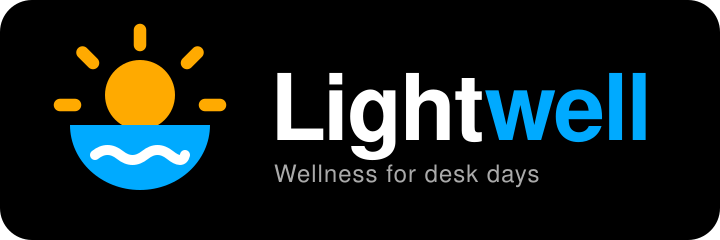

# Lightwell

A Garmin Connect IQ watch app that counts the daylight you get, using the watch's solar charging sensor. Built for the Fenix 7 Pro at the Tech Thursday x Garmin Hackathon in Calgary on November 14, 2026.

## Why

On the day this was built the sun in Calgary rose at 8:50 AM, set at 5:51 PM, and never climbed higher than 21 degrees. It is easy to spend the whole of that indoors. The watch already has a sensor that measures sunlight so it can charge itself. Lightwell reads the same sensor and counts the light toward a daily goal of 20 minutes.

## What it does

- **Ring.** Minutes of light today against the goal, the time of sun left, and the streak. One missed day does not break the streak.
- **Sun finder.** A dot shows where the sun is from where you stand, with its height and the sunset time. The page turns with the compass.
- **Week.** Six finished days and today against the goal line.
- **Sensors.** What each sensor reads right now.
- **Nudges.** A vibration when you have been sitting, the sun is up and the ring is not full. A second check asks you to uncover the watch when you are walking outdoors and the sensor reads dark.
- **Background.** While the app is closed, a background service reads the sensor every 5 minutes, which is the shortest interval Connect IQ allows, and can ask you to step outside.

## Sensors

| Sensor | Used for |
|---|---|
| Solar sensor | The light reading that fills the ring |
| GPS | Sunrise, sunset, and the sun's direction and height at your location |
| Compass | Turning the sun finder to match the way you face |
| Accelerometer and steps | Telling light minutes spent moving from light minutes spent sitting |
| Heart rate | Heart rate when you stepped into light against heart rate now |
| Barometer | A pressure drop over 3 hours shows "go now" before cloud arrives |

## Run it

1. Install the Connect IQ SDK 9.1.0 and the Monkey C extension for VS Code.
2. Open this folder in VS Code and run it on `fenix7pro` (Ctrl+F5).
3. In the simulator, set the position to your city and move the solar intensity control.

UP and DOWN change the page. START steps a demo light level (off, 0, 15, 60, 100) that runs 60 times faster and is labelled DEMO on screen. Holding UP clears today.

## Limits

- `solarIntensity` is a charge efficiency from 0 to 100, not lux. The cut-off of 5 for "brighter than a room" has not been calibrated on a watch.
- In the background one reading stands for the 5 minutes since the last one.
- A sleeve covers the sensor. The app can ask you to uncover the watch but cannot see through fabric.
- It has run in the simulator only.
